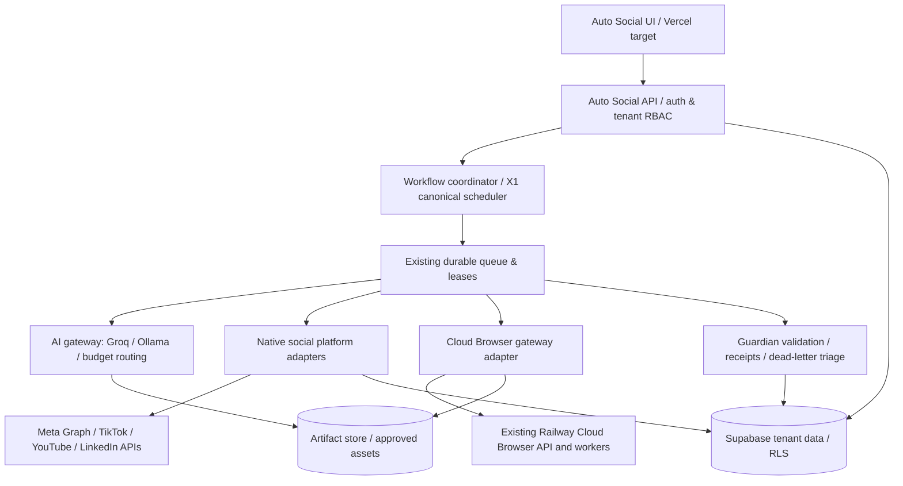

# AUTO SOCIAL — Cloud Browser and Social API Convergence Architecture

**Mission:** AS-CB-ARCH-20261020
**Version:** 0.1.0 (design/preview)
**Source repositories:** [AUTO SOCIAL](https://github.com/Strategic-Minds-AI/auto-social), [Cloud Browser](https://github.com/XTREME-SYSTEMS/cloudbrowser-control)
**Baseline AUTO SOCIAL main commit:** `0f3147b1c839cbbff887e58461a2044d0c7e5796`
**Production changes:** None authorized or requested. This branch contains design and deterministic policy code only.

## 1. Goal and non-goals

One SaaS workspace for independent businesses to connect authentic social accounts, research trends, prepare and produce compliant content, schedule/publish via approved APIs, answer eligible inbound conversations, and measure performance. Reuse X1 scheduler/leases and existing Railway Cloud Browser; do not fork a second browser engine or a competing job queue.

Non-goals: fake or misrepresented personas, mass account registration, ban evasion, CAPTCHA/MFA circumvention, bulk unsolicited DMs/comments, browser-scripted posting in lieu of permissioned platform APIs, harvesting private content, cloning copyrighted videos, fabricated social proof.

## 2. Inspected baseline and constraints

- AUTO SOCIAL is a Vite/React + Base44 application. `base44/functions/generateAutoSocialPlan/entry.ts` currently invokes `base44.integrations.Core.InvokeLLM`. Data uses Base44 entities and a Monday `06:00 UTC` weekly workflow. This is a planning app, not an independently deployed publishing backend.
- AUTO SOCIAL `ScheduledPost` supports planned/scheduled/published/failed; no verified social OAuth, outbound publish adapter, webhook inbox, or durable status reconciliation was observed in this audit.
- Railway `cloudbrowser-control` project contains nine services including existing browser engines and Postgres. Deployment `SUCCESS` indicates a running container, not browser end-to-end functional proof.
- Cloud Browser portable `api/openapi.json` exposes `/health`, `/v1/jobs`, and `/v1/sessions`. Current `ALLOWED_JOB_TYPES` in `api/lib/jobs.js` is `engine.health` and `artifact.prune`; it DOES NOT support `social.*` jobs. The inspected `api/routes/sessions.js` lacks `/v1/sessions/{id}/execute`. A bridge extension must be separately designed/tested on its own branch, never assumed.
- Cloud Browser requires `x-api-key` and enforces tenant identity. Do not expose that secret to the frontend. No public endpoint or working social session credential has been verified.
- Railway live status and source truth require recheck before a deploy; an environment-status read exposed pending-work metadata not reflected in one describe-environment read. Avoid applying existing staged patches accidentally.

## 3. Component topology

**Boundary:** Frontend sends intent, never credentials. Server checks tenant, owner grants, action policy, platform capability, media provenance, rate budgets, idempotency, and approval receipt BEFORE dispatch. All browser results are untrusted observations, not authorization.

## 4. Two automation lanes

### A. Native API lane — preferred for production social writes

- **Onboard:** OAuth, account ownership check, grant & expiry monitoring; platform-specific scope review. Human conducts identity/signup/consent steps and platform developer review where required.
- **Publish:** after consent and scoped publishing approval, enqueue `social.post.publish` through existing X1 queue only after registered in the canonical job type registry. Use per-platform idempotency and status reconciliation; dedupe webhook callbacks.
- **Inbox:** provider webhook → signature validation → channel-scoped inbox record → AI classification → approved reply template or human review → outbound API response → external receipt and metrics.
- **Analytics:** user-account insights and permitted public aggregates; normalized by account, post, campaign, and tenant.

### B. Cloud Browser lane — permitted observation/assistance

- Public trend research only for sources and access methods permitted by source policy; prefer licensed APIs or RSS.
- Screenshot/visual QA of authenticated business dashboards that the owner authorizes, including upload preview inspection and accessibility checks.
- Human-present registration walkthrough: prepare profile copy and assets, navigate to signup pages, fill permitted non-sensitive fields, stop for CAPTCHA, phone/email validation, MFA, identity, consent, terms and final submission.
- Own-domain brand and landing-page QA, competitor/public creative pattern analysis without copying protected media.
- **No unattended automated account creation, social posting, following, liking, commenting, DMs, access-rule bypass, private data harvesting, or evasion.**

Cloud Browser adapter must accept typed intents and select only documented executable methods verified in sandbox. Because the inspected portable API has no supported session execution endpoint, initially implement `browser.inspect` only after contract tests prove the chosen engine entrypoint. If no entrypoint is verified, return `BLOCKED_CAPABILITY` and use a human link rather than inventing one.

## 5. Workflow state machines

**Accounts:** `requested → profile_ready → human_signup_pending → verification_pending → oauth_pending → connected → permission_verified → active`. Rejected/expired grants move to `reconnect_required`. Never store passwords, OTPs, or raw cookies in AUTO SOCIAL records.

**Content:** `brief → drafted → quality_checked → media_ready → scheduled → publish_pending → publishing → confirmed`. Alternatives: `approval_required`, `failed_retryable`, `dead_letter`, `cancelled`. A response from the publish API is not evidence that content is publicly visible; reconcile using provider status.

**Engagement:** `inbound_received → classified → safe_reply_candidate → auto_reply_permitted OR review_required → provider_sent → recorded`. Unknown, sensitive, complaint, medical, legal, financial, identity, adversarial, spam or abusive content escalates. Outbound lead engagement is `suggestion → owner_review → permitted_one_to_one_action`, not bot-initiated mass outreach.

**Research:** `source_allowlist → terms/robots/licence check → public observation → attribution → summary → ephemeral artifact expiry`.

## 6. Provider capability matrix (verify credentials/app review before enabling)

| Provider | Account setup | Publishing | Owned-page comments / inbox | Automation surface |
|---|---|---|---|---|
| Meta Facebook Pages | Human business setup + Meta auth | Graph API where approved | Eligible Page & Messenger APIs with review/scopes | API |
| Instagram professional | Human setup + Instagram/Meta OAuth | Professional content publishing | Owned media comments and eligible inbound messaging | API |
| TikTok | Human signup + developer OAuth | Video/photo Content Posting API, app review/audit for public direct post | Only documented approved permissions; do not assume general DM/reply API | API / human handoff |
| YouTube | Human channel creation + Google OAuth | Data API `videos.insert` | Eligible comment APIs with exact scopes | API |
| LinkedIn Pages | Human setup + organization admin consent | Marketing/Community APIs with product approval | Community management APIs for authorized orgs | API |
| Other networks | Human signup + source-specific OAuth | Feature-gated after official documentation & terms review | Feature-gated | None until verified |

Current sources: https://developers.tiktok.com/docs/en/content-posting-api-get-started ; https://developers.google.com/youtube/data/reference/rest/v3/videos/insert ; https://learn.microsoft.com/en-us/linkedin/marketing/community-management/community-management-overview ; https://www.postman.com/meta/instagram/documentation/6yqw8pt/instagram-api

## 7. Proposed operational contracts

All X1 queue requests use `tenant_id`, `business_id`, `account_id`, `action`, `source_sha`, `idempotency_key`, `approval_receipt_id`, `policy_version`, `max_cost_cents`, `dry_run`, `attempt_limit`, `trace_id`, `scheduled_at`, and an opaque `payload_ref`. Do not add these job types to Cloud Browser's portable queue blindly; register in the existing canonical scheduler/queue first. Browser session actions need independent integration tests and tenant key scopes.

Events: `account.onboarding.started`, `account.connected`, `content.drafted`, `post.approved`, `post.published`, `comment.received`, `reply.approved`, `reply.sent`, `provider.grant.expired`, `job.failed`. All events use stable IDs and store provider response ID and timestamp.

**Core data (Supabase target, migrations only after review):** `tenants`, `businesses`, `social_accounts` (NO secrets), `social_grants` (vault reference only), `content_items`, `media_assets`, `scheduled_posts`, `provider_delivery_receipts`, `inbox_threads`, `messages`, `approvals`, `source_provenance`, `usage_ledger`. Tenant-scoped RLS, service roles server-only, secret vault for OAuth tokens. Integrate with existing X1 job tables, not duplicate.

**MCP/plugin candidate (do not install until backend exists):** `social_accounts_list`, `social_brand_onboarding_prepare`, `social_campaign_draft`, `social_queue_preview`, `social_inbox_triage`, `social_research_snapshot`, `social_action_receipts`. The first release is read/draft/preview. Each write action must check backend privileges and explicit customer grants.

## 8. Cost and scale

Prefer inference router with per-business budgets and cheap models (Groq / small Ollama) for classification/caption candidates. Use stronger models only for final creative QA or complex briefs. Set concurrency quotas for browser sessions; screenshot only when needed and store expiring artifacts. Prefer existing Railway services and no second persistent queue, scheduler, or database unless a measured requirement proves necessary. Rate-limit by platform and customer; exponential backoff on retryable errors; never retry 401/403/429 blindly or reattempt an uncertain publish without reconciling the provider ID.

## 9. Security/acceptance gates

- No action unless `decideSocialAction` allows it AND server independently verifies JWT/service identity, tenant RLS, OAuth scopes and provider capability. This lightweight policy module is a guardrail, not sufficient authorization alone.
- Never store credentials in public Git, logs, prompts or model context. Challenge or MFA interrupts automation.
- Outbound communication and public publishing require scoped approval settings and receipts. Business owner can revoke accounts and trigger kill switch.
- All platform writes have provider response receipt, idempotency, audit log and rollback/unpublish path where supported.
- Sandbox contract tests, tenant-crossing denials, replay/duplicate tests, browser allowlist tests, webhooks signature tests, provider sandbox smoke, cost ceilings, security QA and Guardian evidence required before production.
- This branch makes **no production changes**; no write jobs, tokens or published posts are attempted.

## 10. Prioritized implementation packets

1. **AS-001: Architecture + policy checks.** Present draft branch and deterministic tests; collect review.
2. **AS-002: Connection foundation.** Reuse existing X1 lease/queue; build secure OAuth callback and account registry, docs and consent receipts; Meta test account first.
3. **AS-003: Native publication + inbox.** One authorized Meta professional/Page sandbox account, draft → approve → publish → verify, one inbound comment → triage → approve → API reply → verify.
4. **AS-004: Browser research adapter.** Existing Cloud Browser auth, verified session execution path, public source allowlist, screenshot receipt, no platform writes.
5. **AS-005: Multi-tenant SaaS.** Supabase RLS, user roles, budgets, AI generation, analytics, media, A/B tests and MCP tool facade; verify third-party OAuth/app reviews before launch.

**Deployment barrier:** Commit/PR may be created on a feature branch. Production schema, secrets, live publishing, account onboarding or Railway deploy require scoped authorization and independent QA evidence.
